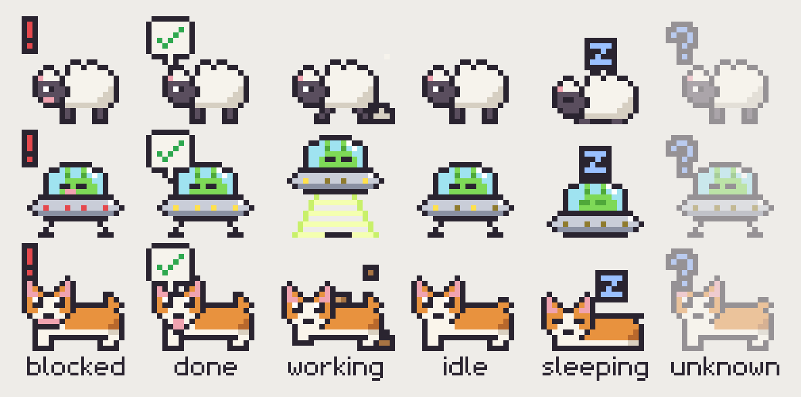
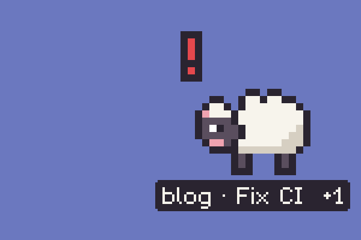
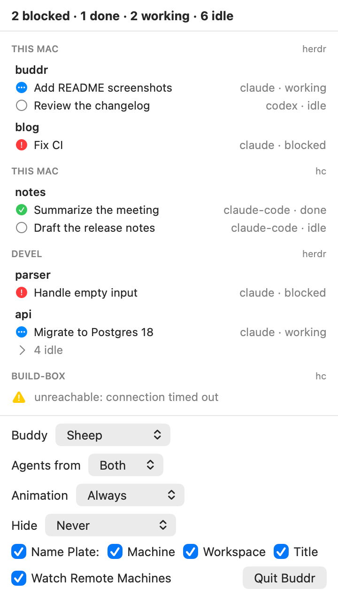

# Buddr

Buddr is a desktop buddy for AI coding agents: a small pixel-art character (a sheep by default) that sits in a
corner of your macOS screen and shows what your agents are up to – busy, waiting for you, or done. Think Clippy, but it
only tells you, it never gets in your way.

<p align="center">
  
</p>

The sheep, the UFO and the corgi are a few of the buddies to choose from; the others are in the
[menu bar](#the-menu-bar) settings.

It watches the agents in [herdr](https://herdr.dev), a terminal workspace for running coding agents side by side, and
in herdr-core (`hc`), the terminal runtime behind herdr-app – on this Mac and on the machines added to them. One buddy
shows all agents together.

## What the sheep shows

| Agent state | The sheep… |
|---|---|
| working | trots in place, bits flying around |
| blocked (waiting for you; also herdr-core's `error`) | jumps, with a blinking "!" |
| done | does a happy jump, shows a "✔" |
| idle | blinks, looks around, falls asleep after a while |
| no agents, or herdr isn't running | is dimmed, with a "?" |

With several agents, the most urgent state wins: blocked > done > working > idle.



While the sheep is blocked or done, a small plate under it names the agent that got there last –
`machine · workspace · title`, the machine only for remote agents – with `+N` for the other agents in the same state.

Click the sheep to pet it. Drag it anywhere; it stays on its screen and remembers the position. When a fullscreen app
covers its display, the sheep runs off the screen and comes back when the app is gone.

<br clear="right">

## The menu bar

<picture>
  <source media="(prefers-color-scheme: dark)" srcset="docs/images/menu-dark.png">
  
</picture>

The sheep in the menu bar opens a list of all agents, grouped by machine and workspace, followed by the settings:

- **Buddy** – the corgi, the Earth, the rainbow cat, the sheep (the default) or the UFO, or all of them taking turns
  every 15 to 60 minutes; a turn ends only while no agent needs you. The old buddy walks off the screen and the new
  one runs in.
- **Agents from** – herdr, hc or both (the default). A chosen one that isn't installed or running shows up with a ⚠.
- **Animation** – always, only for a while after a change (5 s to 1 min), or off: a still picture of the state.
- **Hide** – never (the default), when all agents are idle, or unless one needs you, after 1 to 30 minutes of it. The
  sheep walks off the screen and comes back as soon as that changes; "Show Sheep" in the list calls it back sooner.
- **Name Plate** – on or off, and which parts it shows.
- **Watch Remote Machines** – off reads this Mac only.

A machine that can't be reached shows up with a ⚠ and its error in the list; the sheep doesn't count it.

<br clear="right">

## Install

Buddr runs on Apple Silicon and Intel Macs with macOS 14 or later, and is signed and notarized by Apple.

With [Homebrew](https://brew.sh):

```bash
brew install --cask jsyrovy/tap/buddr
open -a Buddr
```

The full name trusts only this cask of the [tap](https://github.com/jsyrovy/homebrew-tap). To use the short name
(`brew upgrade --cask buddr`), trust it first: `brew trust --cask jsyrovy/tap/buddr`.

Or by hand:

1. Download `Buddr-<version>.zip` from [Releases](https://github.com/jsyrovy/buddr/releases).
2. Unzip it, move `Buddr.app` to Applications and open it.

The sheep appears in the bottom-right corner of the screen, and a pixel-art sheep in the menu bar. There is no Dock
icon: quit Buddr with "Quit Buddr" at the bottom of the menu bar list. To start it at login, add it in System Settings
→ General → Login Items.

To uninstall, quit Buddr and delete the app; `defaults delete cz.jsyrovy.buddr` removes its settings too. With
Homebrew, `brew uninstall --cask jsyrovy/tap/buddr` quits and removes it (`--zap` removes the settings as well).

Changes are in [CHANGELOG.md](CHANGELOG.md).

## Requirements

- macOS 14 Sonoma or later
- [herdr](https://herdr.dev) (tested with 0.9.3), looked up in `PATH`, `/opt/homebrew/bin` and `/usr/local/bin`,
  and/or herdr-core (tested with 0.1.16) running in its default session
  (`~/.local/state/herdr-core/default/default.sock`). An agent shows as done until you have seen it in herdr-app
  0.1.12 or later; with older clients, until it starts working again.

## Privacy

Buddr only reads: it asks herdr (`herdr agent list`, `workspace list`, …) and herdr-core's socket for the agents'
state, and never focuses, controls or sends anything to an agent. It never starts herdr-core when it isn't running.
Buddr itself makes no network connections; for remote machines, herdr connects over its own SSH setup and herdr-core
over its own connections. "Watch Remote Machines" turns these queries off.

## Building from source

Requires Xcode 27 (Swift 6).

```bash
git clone https://github.com/jsyrovy/buddr.git
cd buddr
make run      # builds the Debug app into build/DerivedData and opens it
make install  # builds Release, installs it to ~/Applications and opens it
```

Install somewhere else with `make install INSTALL_DIR=/Applications`; `make uninstall` removes the app again.
[CLAUDE.md](CLAUDE.md) is the developer documentation: the other make targets, structure, conventions and design
decisions.

## Why not the Mac App Store

The App Sandbox forbids running the `herdr` binary installed on the system (which runs `ssh` for remote machines) and
reaching herdr-core's socket outside the app's container, and Buddr does nothing without them.

## License

[MIT](LICENSE) – code and artwork.
